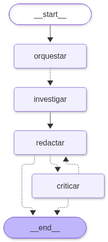
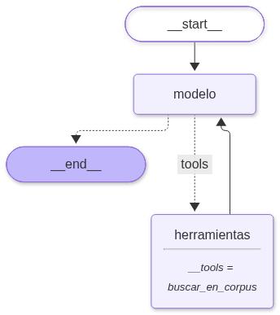
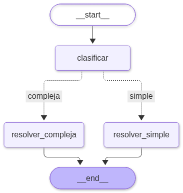
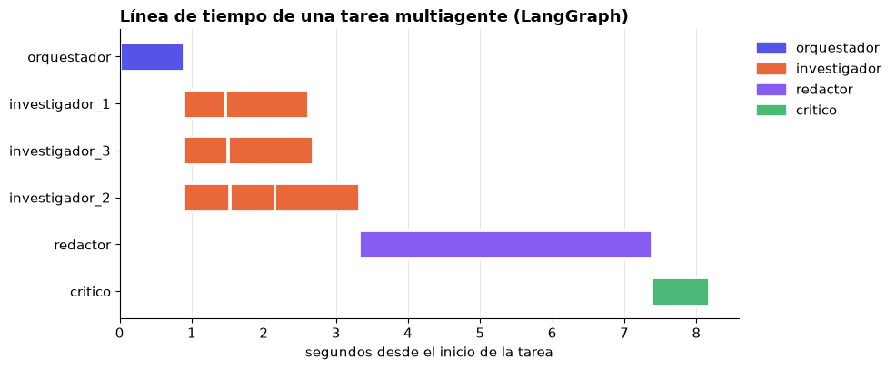
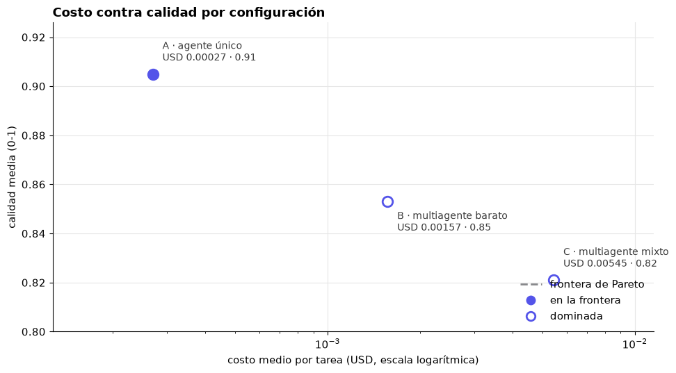
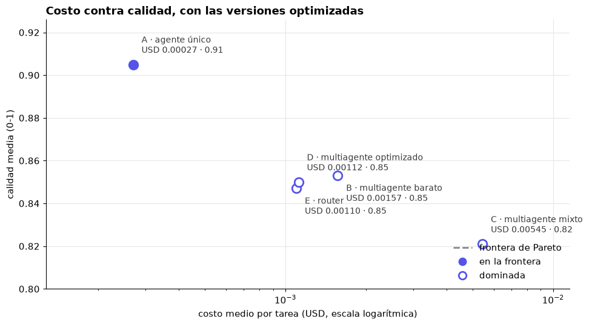

# Arquitectura multiagente: diseño, implementación y medición

Sistema de varios agentes de IA que responde preguntas de negocio y se compara, con modelos reales, contra un agente único. Se mide **calidad, costo, latencia, robustez y costo de coordinación**, para decidir con datos si el multiagente vale la pena.

**Caso guía.** La *Tostaduría Samán* (empresa **ficticia** de Cali) debe decidir su próxima inversión. Los agentes consultan una base de conocimiento interna de 11 documentos y responden citando las fuentes (`[D2]`, `[D7]`...).

> Partimos de los notebooks base del curso (repositorio del profesor `armandoordonez/multiagente`). Este repositorio es nuestra versión ejecutada, corregida y documentada.

## Índice
1. [Contenido del repositorio](#1-contenido-del-repositorio)
2. [Qué hicimos](#2-qué-hicimos)
3. [Cómo funciona el multiagente](#3-cómo-funciona-el-multiagente)
4. [Cómo se comparten información y memoria](#4-cómo-se-comparten-información-y-memoria)
5. [Un ejemplo real, paso a paso](#5-un-ejemplo-real-paso-a-paso)
6. [Cómo se mide](#6-cómo-se-mide)
7. [Resultados](#7-resultados)
8. [Conclusiones](#8-conclusiones)
9. [Qué corregimos respecto a los notebooks base](#9-qué-corregimos-respecto-a-los-notebooks-base)
10. [Cómo correrlo](#10-cómo-correrlo)
11. [Limitaciones y pendiente](#11-limitaciones-y-pendiente)

---

## 1. Contenido del repositorio

| Archivo | Qué es |
|---|---|
| `arquitectura_multiagente_langgraph.ipynb` | Versión con **LangGraph**: el flujo entre agentes es un grafo de estados. Ejecutado con modelos reales. |
| `arquitectura_multiagente.ipynb` | Versión **desde cero** (sin frameworks, solo el SDK `openai` apuntando a OpenRouter). Ejecutado con modelos reales. |
| `resultados_langgraph.csv` | Una fila por tarea: calidad, costo, latencia, llamadas, etc. (LangGraph). |
| `trazas_langgraph.csv` | Una fila por llamada al modelo: agente, modelo, tokens, costo, latencia. |
| `img/` | Gráficas exportadas del notebook de LangGraph (grafos, Gantt, Pareto). |
| `pyproject.toml`, `uv.lock` | Dependencias, gestionadas con `uv`. |

## 2. Qué hicimos

1. **Revisamos** el repositorio del profesor: dos notebooks que implementan el mismo sistema multiagente, uno con LangGraph y otro desde cero.
2. **Los hicimos funcionar**: instalamos las dependencias que faltaban, corregimos celdas rotas y errores propios de DeepSeek (ver [sección 9](#9-qué-corregimos-respecto-a-los-notebooks-base)).
3. **Los ejecutamos con modelos reales** de DeepSeek a través de OpenRouter, con un juez de otra familia (Claude Haiku) para evitar sesgo.
4. **Medimos cinco configuraciones** (A–E) sobre 8 preguntas repetidas 3 veces (24 tareas por configuración, ≈ 1.000 llamadas, ≈ 0,25 USD por notebook).
5. **Analizamos los resultados** y los documentamos aquí, incluidas las limitaciones.

## 3. Cómo funciona el multiagente

```
                 ┌──────────────┐
  pregunta ───▶  │ Orquestador  │  divide en subtareas (JSON)
                 └──────┬───────┘
          ┌─────────────┼─────────────┐        en paralelo
   ┌──────▼─────┐ ┌─────▼──────┐ ┌────▼───────┐
   │Investigador│ │Investigador│ │Investigador│  buscan en el corpus y resumen con citas
   └──────┬─────┘ └─────┬──────┘ └────┬───────┘
          └─────────────┼─────────────┘
                 ┌──────▼───────┐   rechaza   ┌──────────┐
                 │   Redactor   │ ◀────────── │  Crítico │  rúbrica (JSON)
                 └──────┬───────┘ ──────────▶ └──────────┘
                        ▼            propone
                  respuesta final
```

Grafo real generado por LangGraph:



### Los agentes

| Agente | Qué hace | Herramientas | Modelo |
|---|---|---|---|
| **Orquestador** | Divide la pregunta en hasta 3 subtareas independientes (ventas, costos, riesgos...). Responde JSON validado con Pydantic. | ninguna | `deepseek-v4.1-flash` |
| **Investigador** (×N) | Resuelve **una** subtarea: busca en el corpus y entrega hallazgos con cifras y citas `[D#]`. Se ejecutan **en paralelo**. | `buscar_en_corpus` | `deepseek-v4.1-flash` |
| **Redactor** | Con las notas escribe la respuesta final (máx. 200 palabras, con recomendación explícita y citas). | ninguna | `deepseek-v4.1-flash` (C: `deepseek-v4-pro`) |
| **Crítico** | Verifica con una rúbrica: responde la pregunta, recomienda, cita cada cifra, no excede las notas. Devuelve `{aprobado, puntaje, comentarios}`. Si rechaza, el redactor corrige (máx. 2 rondas). | ninguna | `deepseek-v4.1-flash` (C: `deepseek-v4-pro`) |
| **Router** (solo config. E) | Clasifica la pregunta: *simple* → agente único, *compleja* → equipo multiagente. | ninguna | `deepseek-v4.1-flash` |
| **Juez** (solo evaluación) | Califica las respuestas contra puntos clave esperados. | ninguna | `anthropic/claude-haiku-5.5` |

Solo los investigadores pueden buscar. El orquestador, el redactor y el crítico no tienen herramientas: cada agente tiene un prompt **corto y enfocado** y solo lo que necesita.

### Patrones de diseño usados
- **Orquestador–trabajadores:** un agente reparte el trabajo a otros.
- **Paralelización (map-reduce):** los investigadores corren a la vez; en LangGraph se hace con `Send`, y en la versión desde cero con `asyncio.gather`.
- **Evaluador–optimizador:** el crítico evalúa y el redactor mejora el borrador.
- **Enrutamiento (router):** un clasificador barato decide qué arquitectura usar.

### La herramienta de búsqueda
`buscar_en_corpus(consulta)` busca por **palabras clave** (normaliza acentos, quita palabras vacías y puntúa por términos en común) y devuelve hasta 3 documentos con `id`, `título` y `texto`. En un sistema real sería un buscador vectorial o una base de datos. Cada vez que un agente la usa se registra qué documentos consultó, para medir después el trabajo repetido.

### Controles de costo y robustez
- **Tope de gasto por tarea:** 0,05 USD; si una tarea lo supera, se corta la siguiente llamada.
- **Criterio de parada:** `max_pasos` por agente; al agotarse, se fuerza una respuesta sin herramientas. El crítico tiene `max_rondas_critico = 2`.
- **Reintentos** con espera exponencial ante fallos de la API.
- **Degradación elegante:** si el plan del orquestador llega con formato inválido o cortado, se usa **una sola subtarea**; si la evaluación del crítico llega inválida, la respuesta se da por **aprobada** (y queda registrado en la traza). Así un error de formato no tumba la tarea.
- **Concurrencia limitada:** 3 tareas simultáneas (y 4 llamadas simultáneas en la versión desde cero), para no chocar con límites de tasa.

### Las cinco configuraciones

| | Descripción |
|---|---|
| **A** | **Agente único** con todas las herramientas (línea base). |
| **B** | **Multiagente barato:** todos los roles con `deepseek-v4.1-flash`. |
| **C** | **Multiagente mixto:** orquestador, redactor y crítico con el modelo fuerte `deepseek-v4-pro`; investigadores con el barato. |
| **D** | **Multiagente optimizado:** 2 subtareas, 1 ronda de crítico, resúmenes de 80 palabras (menos paralelismo, parada temprana, compresión de contexto). |
| **E** | **Router:** simple → agente único, compleja → equipo optimizado. |

Grafos de las versiones con un agente y con router:

| Agente único | Router |
|---|---|
|  |  |

## 4. Cómo se comparten información y memoria

**Los agentes no comparten una memoria global.** Es una decisión de diseño: cada agente ve solo lo que necesita, lo que mantiene los contextos cortos y baratos (menos tokens). Hay tres niveles:

1. **Memoria propia de cada agente** = su historial de mensajes (`MessagesState` en LangGraph; la lista `mensajes` en la versión desde cero). Contiene la pregunta, sus búsquedas y los resultados de la herramienta. Se descarta cuando el agente termina. Cada investigador **solo ve su subtarea**, no lo que hacen los demás.
2. **Estado compartido** (solo LangGraph): el `EstadoMulti` es el contrato entre agentes, un diccionario común:

   | Clave | Quién la escribe | Quién la lee |
   |---|---|---|
   | `pregunta` | entrada | todos |
   | `subtareas` | orquestador | reparto (`Send`) |
   | `notas` | **cada investigador** (reductor `operator.add`) | redactor y crítico |
   | `borrador` | redactor | crítico |
   | `comentarios`, `aprobado`, `rondas` | crítico | redactor / control del ciclo |

   Cada nodo lee solo las claves que necesita y devuelve solo las que cambia. El reductor `operator.add` en `notas` es lo que permite que varios investigadores en paralelo escriban a la vez sin pisarse: LangGraph junta sus listas.
   En la versión **desde cero** el mismo trabajo lo hace el código: `asyncio.gather` devuelve las notas de los investigadores y se pasan como texto al redactor.
3. **Lo que no hay:** memoria entre tareas ni entre ejecuciones. Cada pregunta empieza de cero (no usamos `checkpointer`). Agregarla (por ejemplo con `MemorySaver` para humano en el bucle) es el ejercicio 4 del notebook y queda pendiente.

**Qué se "pasan" los agentes:** el orquestador entrega subtareas → los investigadores entregan notas con cifras y citas → el redactor entrega un borrador → el crítico entrega comentarios → el redactor corrige. La comunicación entre ellos es **JSON validado** (orquestador y crítico) o texto con citas (investigadores y redactor), de modo que los errores de formato se detectan en el borde.

## 5. Un ejemplo real, paso a paso

Pregunta: *«¿Qué opción de expansión conviene más si la junta exige recuperar la inversión en menos de 24 meses?»*

**Recorrido del grafo** (`stream_mode="updates"`, un evento por nodo que termina):

```
orquestar    actualizó: subtareas, rondas, comentarios, notas
investigar   actualizó: notas        ← tres investigadores, en paralelo
investigar   actualizó: notas
investigar   actualizó: notas
redactar     actualizó: borrador
criticar     actualizó: aprobado, comentarios, rondas
```

**Línea de tiempo** de esa ejecución. Los tres investigadores corren a la vez; el **redactor es la ruta crítica** (≈ 4 de los 8 s):



**Costo por rol** de esa misma tarea:

| Rol | Llamadas | Tokens entrada | Tokens salida | Costo (USD) | % del costo |
|---|---|---|---|---|---|
| investigador | 7 | 5.419 | 1.220 | 0,00074 | 55,9 |
| critico | 1 | 1.326 | 81 | 0,00035 | 26,2 |
| redactor | 1 | 999 | 290 | 0,00017 | 13,0 |
| orquestador | 1 | 118 | 90 | 0,00007 | 5,0 |

**Respuesta del agente único (A)** — 2 llamadas, USD 0,00024, 3,2 s:

> **Recomendación: Opción A (tienda online con suscripciones).** Con el requisito de recuperar la inversión en menos de 24 meses, solo la Opción A cumple: inversión de COP 95 millones y punto de equilibrio estimado en **14 meses** [D7]. La Opción B (segunda tienda física) requiere COP 420 millones y tiene punto de equilibrio en **30 meses** [D8]: excede el plazo. La Opción C (exportación a Chile) exige certificación sanitaria de 6 meses y no reporta punto de equilibrio [D9].

**Respuesta del equipo multiagente (B)** — 10 llamadas, USD 0,00132, 8,2 s:

> La opción que conviene más es la **Opción A (tienda online con suscripciones)**, porque es la única con punto de equilibrio documentado dentro del umbral exigido: inversión de COP 95 millones y recuperación estimada en 14 meses [D7]. La Opción B requiere COP 420 millones, arriendo mensual de COP 11 millones y alcanza el punto de equilibrio en 30 meses, por lo que no cumple el requisito de <24 meses [D8]. […] **Recomendación explícita:** aprobar la Opción A […]; conviene además monitorear los riesgos transversales (concentración en clientes B2B y volatilidad del café verde) [D10].

Las dos llegan a la misma recomendación con las mismas cifras correctas. El equipo agrega el contexto de riesgos (documento D10), pero cuesta ≈ 5,5 veces más y tarda ≈ 2,5 veces más.

**Indicadores de coordinación** de esa tarea:

| | A · agente único | B · multiagente |
|---|---|---|
| Llamadas al modelo | 2 | 10 |
| % del costo en coordinación (orquestador + crítico) | 0 % | 31,2 % |
| Documentos consultados | 6 | 19 |
| % de consultas repetidas | 33,3 % | 68,4 % |

## 6. Cómo se mide

- **Trazas.** Toda llamada al modelo pasa por un único punto (`llamar_llm` en la versión desde cero; un *callback handler* `Trazador` en LangGraph). Cada una deja una fila con agente, modelo, tokens de entrada/salida/caché, **costo real reportado por OpenRouter** (`usage.cost`) y latencia. De ahí salen el costo por rol, el Gantt y los indicadores.
- **Dataset.** 8 preguntas de negocio, cada una con sus **puntos clave esperados** (por ejemplo: «la tienda online recupera la inversión en 14 meses»). Se repiten **3 veces** cada una → 24 tareas por configuración, porque las respuestas de los modelos varían entre ejecuciones.
- **Juez LLM de otra familia** (`anthropic/claude-haiku-5.5`) para no calificar a DeepSeek con DeepSeek. Para cada respuesta indica qué puntos clave contiene, y califica fidelidad y claridad:

  | Criterio | Escala | Peso |
  |---|---|---|
  | Cobertura de puntos clave | fracción de puntos presentes | 60 % |
  | Fidelidad (sin cifras inventadas, con citas) | 1 a 5 | 25 % |
  | Claridad y recomendación explícita | 1 a 5 | 15 % |

  El costo del juez se registra aparte para no mezclarlo con el del sistema evaluado.
- **Métricas reportadas:** calidad (media y desviación estándar), cobertura, % de éxito, costo por tarea y por 1.000 tareas, latencia p50 y p95, llamadas y tokens por tarea, **% del costo en coordinación** (orquestador, crítico, router), **% de consultas repetidas** entre agentes y **caché de prompts**.
- **Frontera de Pareto:** una configuración está en la frontera si ninguna otra es a la vez más barata y de mejor calidad; las demás se pueden descartar.

## 7. Resultados

Modelos reales vía OpenRouter, 24 tareas por configuración, 0 juicios fallidos y 100 % de éxito en todas las configuraciones.

### 7.1 Versión LangGraph (`arquitectura_multiagente_langgraph.ipynb`)

| Config | Calidad (0-1) | ± desv. | Cobertura | Costo/tarea (USD) | USD / 1.000 tareas | Latencia p50 | Latencia p95 | Llamadas | Tokens | % coord. | % repetidas |
|---|---|---|---|---|---|---|---|---|---|---|---|
| A · agente único | **0,905** | 0,108 | 0,95 | **0,00027** | 0,27 | **2,41 s** | 3,75 s | 2,1 | 1.951 | 0 | 33,3 |
| B · multiagente barato | 0,853 | 0,133 | 0,88 | 0,00157 | 1,57 | 7,20 s | 10,14 s | 9,2 | 8.998 | 21,3 | 70,6 |
| C · multiagente mixto | 0,821 | 0,145 | 0,86 | 0,00545 | 5,45 | 13,88 s | 25,45 s | 10,0 | 9.634 | 40,1 | 66,4 |
| D · optimizado | 0,850 | 0,139 | 0,89 | 0,00112 | 1,12 | 6,43 s | 17,54 s | 7,2 | 6.029 | 22,1 | 56,9 |
| E · router | 0,847 | 0,158 | 0,89 | 0,00110 | 1,10 | 6,12 s | 13,85 s | 8,2 | 5.959 | 21,3 | 57,9 |

Frontera de Pareto de A, B y C (el agente único domina: es más barato **y** de mejor calidad):



Con las versiones optimizadas D y E:



**Efecto de optimizar, frente a B (multiagente sin optimizar):**

| | Δ costo | Δ calidad (puntos) | Δ latencia p50 |
|---|---|---|---|
| D · optimizado | −28,7 % | −0,003 | −10,7 % |
| E · router | −29,9 % | −0,006 | −15,0 % |

**Calidad por pregunta** (media de 3 repeticiones):

| Pregunta | A | B | C |
|---|---|---|---|
| Opción de expansión con límite de 24 meses | 0,96 | 0,94 | 0,84 |
| Canal que más crece y mejor margen | 0,90 | 0,91 | 0,91 |
| Capacidad de la planta para exportar a Chile | 0,84 | 0,78 | 0,77 |
| Riesgos financieros y operativos | 0,98 | 0,90 | 0,93 |
| Evidencia de demanda para suscripción | 1,00 | 0,95 | 0,88 |
| Financiar la segunda tienda sin crédito | 0,92 | 0,76 | 0,70 |
| Precio del café verde y margen B2B | 0,92 | 0,93 | 0,94 |
| Qué mejorar primero en domicilios | 0,70 | 0,66 | 0,60 |

**Caché de prompts** (tokens de entrada que el proveedor reutilizó, lo que abarata el costo):

| Config | Tokens de entrada | Tokens en caché | % en caché |
|---|---|---|---|
| A | 38.384 | 20.608 | 53,7 |
| B | 193.211 | 61.476 | 31,8 |
| C | 189.763 | 65.328 | 34,4 |
| D | 118.894 | 35.078 | 29,5 |
| E | 117.438 | 35.200 | 30,0 |

**Costo real de toda la sesión** (incluye al juez):

| | Llamadas | USD |
|---|---|---|
| A | 52 | 0,00672 |
| B | 242 | 0,04036 |
| C | 240 | 0,13087 |
| D | 174 | 0,02678 |
| E | 196 | 0,02638 |
| Juez | 120 | 0,01825 |
| **Total** | **1.024** | **0,24938** |

### 7.2 Versión desde cero (`arquitectura_multiagente.ipynb`)

Mismo diseño, mismas preguntas, otra implementación. Sirve para comprobar que los resultados no dependen del framework.

| Config | Calidad (0-1) | ± desv. | Cobertura | Costo/tarea (USD) | Latencia p50 | Latencia p95 | Llamadas | % coord. | % repetidas |
|---|---|---|---|---|---|---|---|---|---|
| A · agente único | 0,869 | 0,156 | 0,89 | **0,00028** | **2,55 s** | 4,82 s | 2,2 | 0 | 24,1 |
| B · multiagente barato | **0,894** | 0,092 | 0,94 | 0,00148 | 12,08 s | 19,48 s | 9,3 | 17,7 | 67,9 |
| C · multiagente mixto | 0,741 | 0,245 | 0,78 | 0,00466 | 16,20 s | 27,23 s | 9,6 | 41,8 | 66,7 |
| D · optimizado | 0,866 | 0,131 | 0,89 | 0,00102 | 7,73 s | 16,41 s | 7,3 | 21,0 | 58,1 |
| E · router | 0,873 | 0,141 | 0,94 | 0,00116 | 8,34 s | 14,09 s | 8,4 | 20,5 | 58,2 |

Costo total de la sesión: **0,22635 USD** (1.015 llamadas, incluye al juez).
En C, la pregunta de riesgos sacó 0,29 en promedio, lo que explica su calidad baja y su desviación estándar de 0,245.

## 8. Conclusiones

1. **Para este problema, el agente único es la mejor opción.** Con 11 documentos y preguntas que se resuelven con pocas búsquedas, el agente único es de **4 a 20 veces más barato** (0,00027 frente a 0,00110–0,00545 USD por tarea) y **2,5 a 6 veces más rápido**, con calidad igual o mejor. Está solo en la frontera de Pareto.
2. **El multiagente tiene un costo de coordinación real.** Sube de 2 a ~9–10 llamadas y de ~2.000 a ~9.000–10.000 tokens por tarea. Entre el 21 % y el 40 % del costo se va en coordinar (orquestador y crítico), y ≈ 70 % de las consultas a documentos son repetidas entre investigadores.
3. **Un modelo más fuerte no ayuda.** La configuración C (`deepseek-v4-pro` en orquestador, redactor y crítico) cuesta **3,5 veces más que B** y no mejora la calidad; además tiene la latencia más alta.
4. **Optimizar sí funciona.** Reducir subtareas, rondas del crítico y longitud de los resúmenes (D) o enrutar (E) baja el costo ≈ 30 % frente a B sin perder calidad. Aun así **no alcanza el reto del ejercicio 3** (costar al menos 40 % menos que B sin perder más de 0,05 de calidad): la calidad se mantiene, pero el ahorro es de ≈ 30 %, no de 40 %.
5. **No encontramos ninguna pregunta donde el equipo supere claramente al agente único** (en LangGraph el agente único iguala o supera a B en 6 de las 8; la mayor brecha es «financiar la segunda tienda sin crédito»: 0,92 frente a 0,76). Es una hipótesis **no probada** que el reparto del trabajo se justifique con un corpus mucho mayor o con preguntas que exijan combinar muchos documentos: este experimento no lo cubre.
6. **Medimos el ruido y es grande.** Con 24 tareas por configuración, la desviación estándar de la calidad es de 0,09 a 0,25, y el **orden entre A y B se invierte** entre las dos implementaciones (LangGraph: A 0,905 > B 0,853; desde cero: B 0,894 > A 0,869). El juez también varía: calificó el mismo texto entre 0,84 y 0,94. Por eso **solo las diferencias de costo, latencia y número de llamadas son firmes**; las diferencias de calidad entre A, B, D y E **no son concluyentes**. Con una sola corrida y un solo juez habríamos podido «demostrar» cualquier ranking.

## 9. Qué corregimos respecto a los notebooks base

- **Resultados simulados.** El notebook «desde cero» traía resultados guardados que coincidían dígito a dígito con el modo simulado (0,843 / 0,731 / 0,775 y respuestas que solo copiaban texto de los documentos). Se reejecutó con modelos reales.
- **Celdas rotas** en ese notebook: ruta absoluta de Windows (`C:\Users\...`), variable `ORIGEN_CLAVE` sin definir y celdas duplicadas. Ahora usa `find_dotenv` y corre en cualquier máquina.
- **Dependencias:** `pyproject.toml` no incluía `langgraph`, `langchain-openai` ni `langchain-core`; se agregaron. Se quitó `%pip install` (no hay pip en un entorno de `uv`).
- **DeepSeek y el razonamiento:** los modelos gastaban los `max_tokens` pensando y cortaban el JSON (`LengthFinishReasonError`). Se desactivó el razonamiento con `reasoning: {enabled: false}` y se subieron los límites del orquestador, crítico y router a 600 tokens y del juez a 1.000.
- **Fallos que tumbaban tareas:** una salida cortada o inválida del router, orquestador o crítico ya no rompe la tarea; cae en el fallback documentado (equipo completo, una subtarea, o respuesta aprobada).
- **Juez roto:** Haiku omitía la clave `claridad` y 21 de 24 juicios fallaban, dejando tablas calculadas con 3 datos. Se dejaron las cuatro claves explícitas y obligatorias en el prompt, y los juicios fallidos se cuentan en la tabla (`juicios fallidos`: 0).
- **Latencia mal medida** (versión desde cero): se lanzaban las 24 tareas a la vez y la latencia incluía la espera en la cola del semáforo (B marcaba 59 s en vez de ~12 s). Se limitaron las tareas simultáneas a 3.
- **Juez independiente:** se pasó de un juez de la misma familia (DeepSeek) a uno de otra (Claude Haiku) para reducir el sesgo de autoevaluación.
- **3 repeticiones por pregunta** y columnas de desviación estándar, número de tareas y juicios fallidos en la tabla resumen.

## 10. Cómo correrlo

Requisitos: [`uv`](https://docs.astral.sh/uv/) y una clave de [OpenRouter](https://openrouter.ai).

```bash
uv sync
echo "OPENROUTER_API_KEY=sk-or-v1-..." > .env     # .env está en .gitignore: nunca se sube
```

Abrir uno de los notebooks en VS Code con el kernel de `.venv` (o `uv add --dev jupyterlab && uv run jupyter lab`) y ejecutar todas las celdas. Una corrida completa cuesta ≈ 0,25 USD y tarda unos minutos.

Si no hay clave, el notebook de LangGraph corre en **modo simulado**: un modelo de chat falso imita las respuestas para que el grafo, las trazas y las métricas funcionen sin gastar crédito. Sus puntajes de calidad **no** describen a ningún modelo real.

Cambiar de modelo es editar el diccionario `MODELOS` (un modelo por rol); cambiar el comportamiento del sistema, editar `Config` (`max_subtareas`, `max_rondas_critico`, `palabras_resumen`, `tope_usd`, modelos por rol).

## 11. Limitaciones y pendiente

- **Corpus pequeño y ficticio** (11 documentos) con búsqueda por palabras clave: favorece al agente único. Los resultados no se pueden extrapolar a problemas con mucha más información.
- **8 preguntas × 3 repeticiones** es una muestra pequeña, y el juez es un LLM con su propia variabilidad.
- **Sin memoria entre tareas** (ver [sección 4](#4-cómo-se-comparten-información-y-memoria)).
- **Ejercicios del notebook sin hacer:** verificador de hechos (1), pipeline fijo en lugar de `Send` (2), humano en el bucle con `MemorySaver` (4), agente prefabricado `create_react_agent` (5) y comparación de ambas versiones en detalle (6). El 3 (reto de costo ≥ 40 % menos que B) **no se alcanzó**: D y E llegan a ≈ 30 %.
- Las gráficas de `img/` salen del notebook de LangGraph; las del notebook desde cero están dentro del propio notebook.
